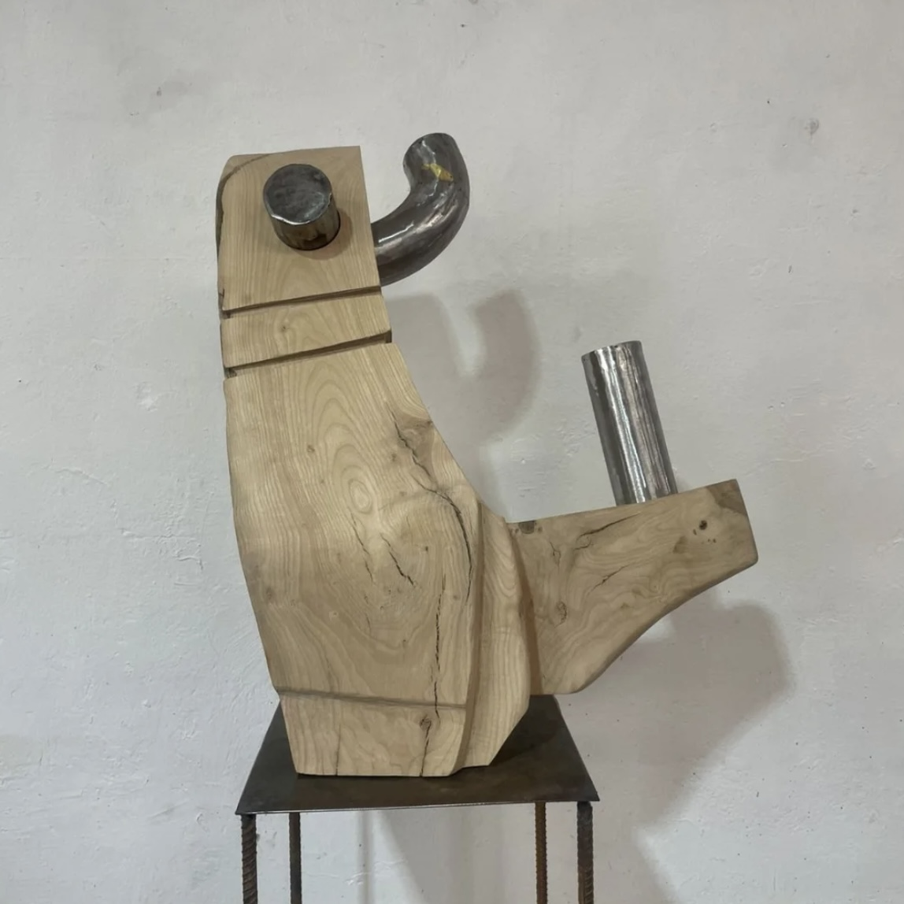
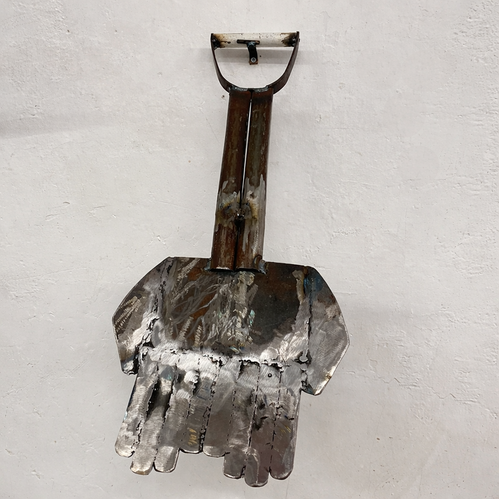
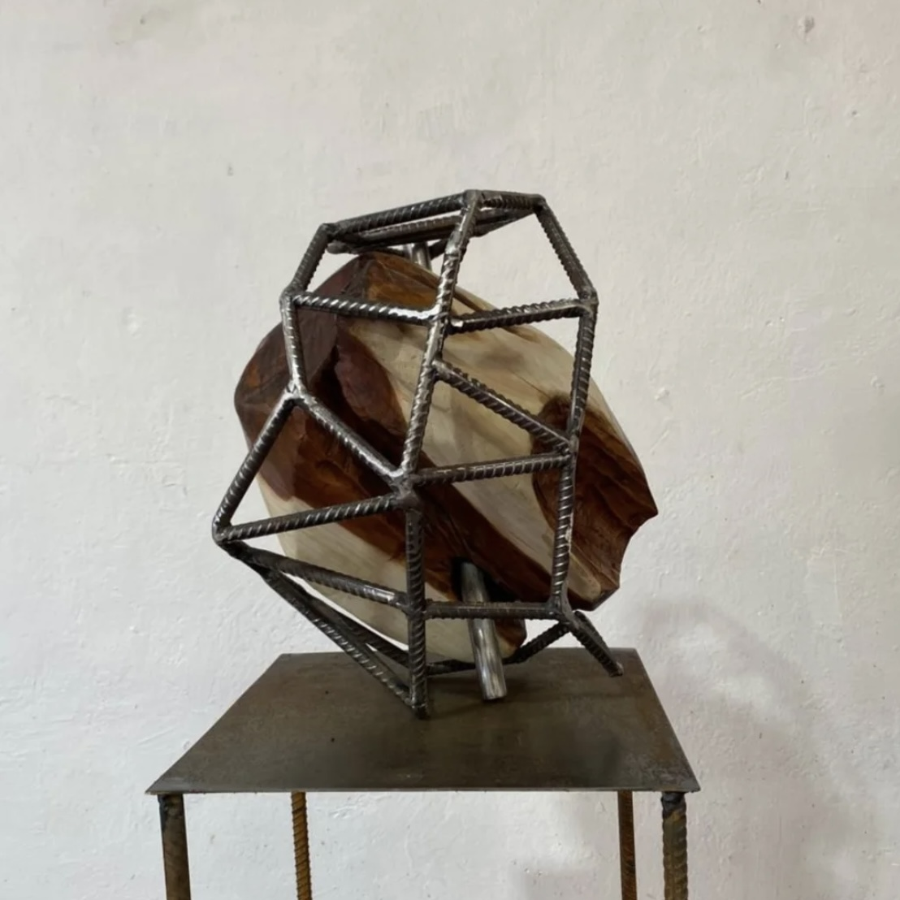
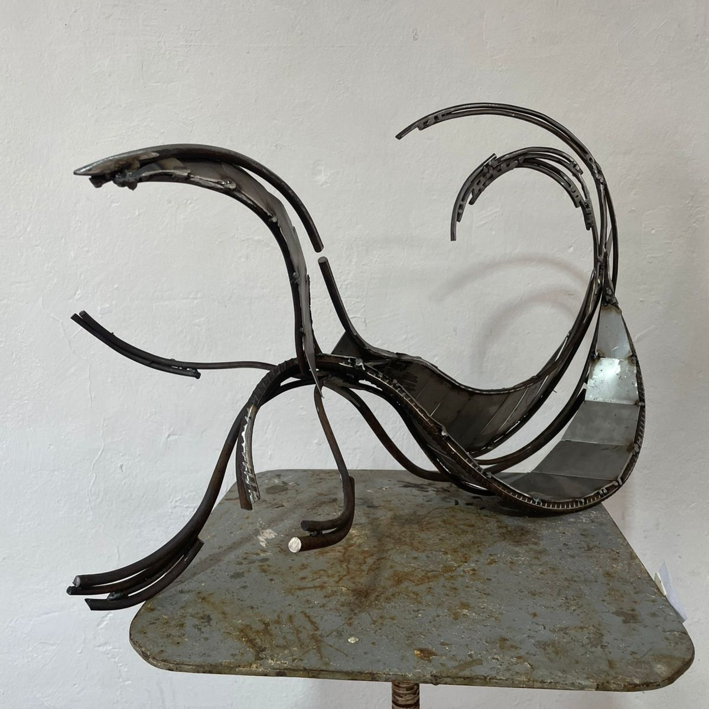
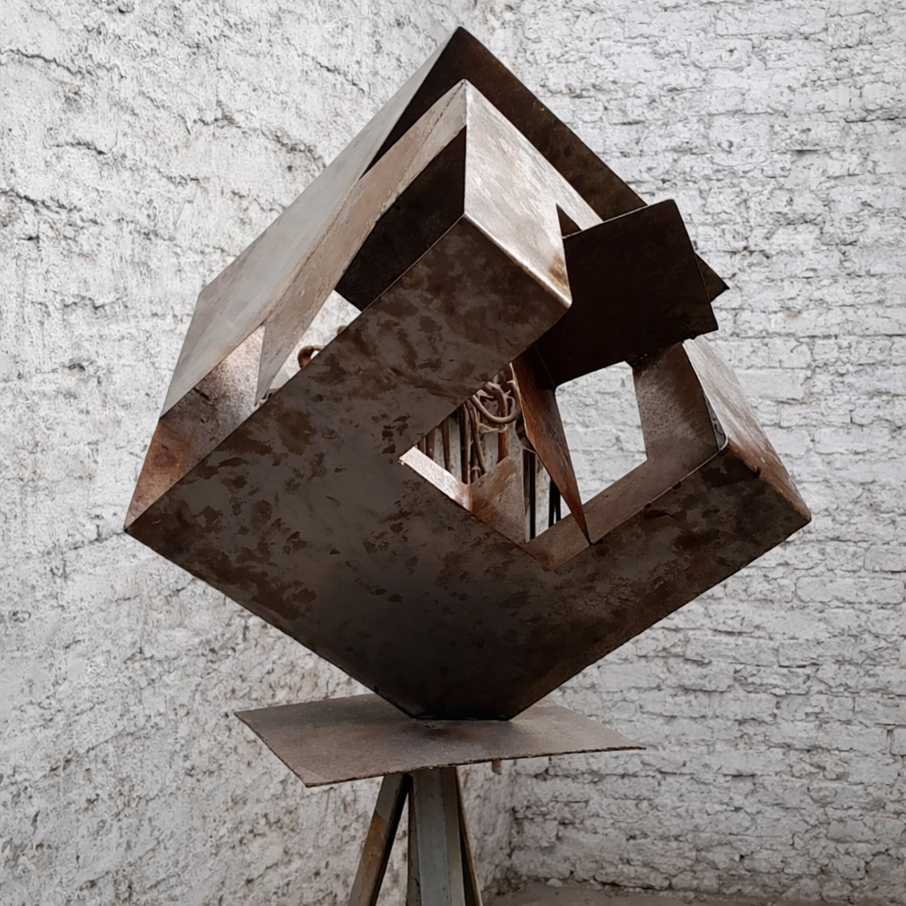
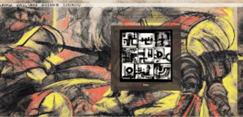

<br><br>
# <font color= "BLUE">TALLERE MULTIMEDIAL
#### <font color= "orange"> BITACORA GENIAL DE ELENEITOR
## Índice:
1. [INCREIBLE Semana 1](#semana-1) <br>
2. [ASOMBROSA Semana 2](#semana-2-avances-con-ia)
3. [ESTUPENDA Semana 3](#semana-3-mini-sitio-3-páginas-conectadas) <br>
4. [MARAVILLOSA Semana 4](#semana-4-css-intermedio-interacción-y-layout) <br>
6. [ESTRAFALARIO Semana 5](#semana-25-touch-designer)<br>
5. [FASCINANTE Semana 8](#semana-8-fascinante-pagina-final)
6. [INCREIBLE Semana 25](#semana-25-touch-designer)<br>


### Semana 1:
``` html
<!DOCTYPE html>
<html lang="es">
<html>
<head>
<meta charset="UTF-8">
<title>ElenaPavezsitio</title>
<style>
body{
  background-color: #F5F4EB;
  color: #827662;
  margin: 0;
  height: 100vh;   
  display: flex;
  justify-content: center;
  align-items: center;
  font-family: Arial, sans-serif;
  font-size: 50px;
}
</style>
</head>
<body>
<div style="text-align: center;">
  Elena Pavez Escultora.<br>
  <!-- Link Instagram -->
  <a href="https://www.instagram.com/epavezs/?hl=es-la" target="_blank" style="font-size:22px; color:#464138; text-decoration:none;">
    Ver Instagram
  </a>
</div>
</html>
```
## Registro del proyecto


  

#### Cuando una persona hace clic en “Ir a la página 2”, el navegador abre pagina2.html.
### Ejemplo 2 con dos páginas:
#### index.html

```html
<!DOCTYPE html>
<html lang="es"></html>
<head>
<title>Mi sitio</title>
    <meta charset="UTF-8">
</head>
<body>
<h1>Página principal</h1>
<a href="pagina2.html">Ir a la segunda página</a>
</body>
</html>
```
#### pagina2.html

```html
<!DOCTYPE html>
<html lang="es"></html>
<head>
<title>Mi sitio</title>
    <meta charset="UTF-8">
</head>
<body>
<h1>Página principal</h1>
<a href="pagina2.html"> Volver a la página principal</a>
</html>
</body>
</html>
```

## Semana 2: AVANCES CON IA
```html
<!DOCTYPE html>
<html lang="es">
<head>
<meta charset="UTF-8">
<title>epavezportafolio</title>

<style>
body {
  background-color: #F5F4EB;
  color: #827662;
  margin: 0;
  font-family: Arial, Helvetica, sans-serif;
}
header {
  display: flex;
  justify-content: space-between;
  align-items: center;
  padding: 30px 40px;
  font-weight: bold;
}
/* LOGO */
.logo {
  font-size: 40px;
  letter-spacing: 3px;
  text-decoration: none; /* quita el subrayado */
  color: #827662;
}
/* LETRAS DE ARRIBA */
nav a {
  margin-left: 20px;
  text-decoration: none;
  color: #464138;
  font-size: 16px;
}
/* GALERIA ESTO DIVIDE LA PAGINA */
.galeria {
  display: grid; /* grilla */
  grid-template-columns: repeat(3, 1fr);
  gap: 25px;
  padding: 40px;
}
.item {
  text-align: left;
}
.item img {
  width: 100%;
  height: auto;
  cursor: pointer;
}
.titulo {
  margin-top: 2px;
  font-size: 12px;
  object-fit: cover;
}
</style>
</head>
<body>
<header>
 <a href="index.html" class="logo">E|PAVEZ</a>
  <nav>
    <a href="bio.html">Bio</a>
    <a href="contacto.html">Contacto</a>
    <a href="https://www.instagram.com/epavezs/?hl=es-la" target="_blank">Instagram</a>
  </nav>
</header>
<div class="galeria">
  <div class="item">
    <a href="timon.html">
      
    </a>
    <div class="titulo">Timón</div>
  </div>
  <div class="item">
    <a href="manodeobra.html">
      
    </a>
    <div class="titulo">Serie Mano de Obra (Pala)</div>
  </div>
  <div class="item">
    <a href="anticucho.html">
      
    </a>
    <div class="titulo">Anticucho</div>
  </div>
  <div class="item">
    <a href="curva.html">
      
    </a>
    <div class="titulo">Curvas & Escalas</div>
  </div>
  <div class="item">
    <a href="forjamano.html">
      
    </a>
    <div class="titulo">Mano de Forja</div>
  </div>
  <div class="item">
    <a href="cube.html">
      
    </a>
    <div class="titulo">Cube</div>
  </div>
<a></a>
</div>
</body>
</html>
```
.gif)
# Semana 3: Mini sitio (3 páginas conectadas)
DEBO PENSAR EN UNA ESTRUCTURA NARRATIVA

#### Crear 3 páginas:
index.html
obra.html
contacto.html

##### index.html:
```html
<!DOCTYPE html>
<html>
<head>
<title>Inicio</title>
</head>

<body>

<h1>Mi sitio</h1>


<br><br>

<a href="obra.html">Obra</a><br>
<a href="contacto.html">Contacto</a>

</body>
</html>
```
##### obra.html:
```html
<!DOCTYPE html>
<html>
<head>
<title>Obra</title>
</head>

<body>

<h1>Mi obra</h1>


<p>Descripción de mi trabajo artístico</p>

<a href="index.html">Inicio</a><br>
<a href="contacto.html">Contacto</a>

</body>
</html>
```
##### contacto.html:
```html
<!DOCTYPE html>
<html>
<head>
<title>Contacto</title>
</head>

<body>

<h1>Contacto</h1>


<p>email@email.com</p>

<a href="index.html">Inicio</a><br>
<a href="obra.html">Obra</a>

</body>
</html>
```
# USÉ MUCHA IA YA NO QUIERO
## Semana 4. CSS Intermedio (Interacción y Layout)

##### Código base:
```html
<<!DOCTYPE html>
<html>
<meta charset="UTF-8">
<title>EPAVEZ</title>
  <style>
     /* Estilo general del cuerpo */
     body {
      background-image: url(img/puo.png); /* ACA PUSE BACKGROUND Y ME SALIO LA OPCION DE B-IMAGE Y LA USÉ */
      background-size: 80%;
      font-family: Arial, sans-serif;
      margin-left: 0px;
      color: #464138;
      font-size: 20px;
      font-weight: bold;  
      }
      /* CONTENEDOR DEL NOMBRE DE ARRIBA*/
      .arriba {
      width: 100%; /* largo del cubito*/
      margin: 20px 0; /* descubriendo como funciona esto*/
      background-color: rgba(245, 244, 235, 0.8); /* hola profe acá le pregunte en google como bajar la opacidad de un contenedor sin que afecte a las letras */
      }
      /* CONTENEDOR DE ABAJO del menuu que probablemente acá no uso*/
.boton { /* Define una clase llamada "boton" */
  justify-content: center; /* Distribuye los elementos con espacio alrededor */
  flex-wrap: wrap;
  margin: 20px auto; /* ESTO lo centra */
  background-color: rgba(68, 66, 59, 0.4); /* Color de fondo del botón Y SE BAJE LA OPASICDAD */
  color: rgb(70, 65, 56); /* Color del texto */
  padding: 20px 10px 20px 10px; /* Espacio interno (arriba → derecha → abajo → izquierda) */
  width: 420px; /* Ancho fijo del botón */
  text-align: center; /* Centra el texto horizontalmente */
  transition: 0.6s; /* Hace que los cambios (como color) sean suaves en 0.3 segundos */
}
.boton img {
 width: 80%;
 height: auto; 
 opacity: 0.4;
}
.boton:hover { /* Se activa cuando el mouse pasa sobre el elemento */
  background-color: rgba(63, 55, 47, 0.822); /* Cambia el color de fondo al pasar el mouse */
  color: #eee8dc; /* Color del texto */
  padding: 25px 15px 25px 15px; /* Espacio interno (arriba → derecha → abajo → izquierda) */
  width: 420px; /* Ancho fijo del botón */
  text-align: center; /* Centra el texto horizontalmente */
  opacity: 1.0;
}
/*PROBANDO SI ESTO FUNCIONA*/
.boton:hover img { /*OMG SI FUNCIONÓ*/
 opacity: 1.0;
 transition: 0.6s; 
}
.boton h6 { /* OMG ESTE TMB FUNCIONO*/
  margin: 5px 0;
}
nav a {
margin-left: 20px;
text-decoration: none; /*este lo aprendí con uno que me dio la ia en la anterior pagina */
color: #464138;
}
</style>
<body>
 <nav class="arriba">
    <a href="index.html">E|PAVEZ</a>
    <a href="obras.html">ESCULTURAS</a>
    <a href="bio.html">BIOGRAFÍA</a>
    <a href="contacto.html">CONTACTO</a>
 </nav>
<div class="boton">
<h6>Hola profesorcito estoy haciendo la pagina denuevo sin copy de la ia, solo con los codigos en su github u,_,u</h6>
</div>
<div class="boton">
        <!-- BLOQUE 1 -->
          
          <h6>Tubos</h6>
        </div>
</body>
</html>
```

#### Ejercicio 3: Flexbox (centrado total)
# NO SÉ DONDE LO PUSE

## Semana 8. FASCINANTE PAGINA FINAL
```html
<!DOCTYPE html>
<html lang="es"></html>
<head>
<meta charset="UTF-8">
<title>EPAVEZ</title>
<link rel="icon" href="img/icon.png" type="image/jpeg">
  <style>
  body {
  font-family: Arial, sans-serif;
  background-image: url(img/cristoout.jpg);
  background-size: 100%;
  margin-left: 0px;
  font-weight: bold; 
  }
  .arriba {
   width: 100%;
   margin: 20px 0; 
   background-color: rgba(0, 0, 0, 0.8); 
   font-size: 40px; 
   transition: 0.3s;
   text-decoration: none;
   }
   .arriba:hover {
    color: #808080;
   }
   .arriba a {
    color: white;
    text-decoration: none;
    font-size: 40px;
   }
.bloque { 
  justify-content: center;
  flex-wrap: wrap;
  margin: 20px auto;
  color: rgb(255, 255, 255); 
  padding: 20px 10px 20px 10px;
  width: 30%;
  text-align: center;
  transition: 0.6s; 
}
.bloque  img {
 width: 80%;
 height: auto; 
 opacity: 0.4;
}
.bloque:hover img { 
 opacity: 1.0;
 transition: 0.6s; 
}
.bloque h6 {
  margin: 5px 0;
}
nav a {
 margin-left: 20px;
 text-decoration: none;
 }
</style>
<body>
 <nav class="arriba">
   <a></a>
    <a href="index.html">E|PAVEZ</a>
    <a></a>
    <a href="obras.html">ESCULTURAS</a>
    <a href="bio.html">BIOGRAFÍA</a>
    <a href="contacto.html">CONTACTO</a>
 </nav>
</div>
<div class="bloque">
<h6>Hi everynyan</h6>
</div>
<div class="bloque">
          
          <h6>Tubos</h6>
        </div>

</body>
</html>
```
# SALTO ÍNCREIBLE A LA SEMANA 25
## SEMANA 25 TOUCH DESIGNER
<br><br>
```
En este extracto, se pueden ver una serie de imágenes superpuestas que van al ritmo de un beat repetitivo con un estilo de música Tech la cual esta mezclado con el sonido de un esmeril. En el extracto se observa el uso de 3 técnicas de trabajo, corte con esmeril, soldadura al arco y forjado
en frío, estas imágenes nos van contando el relato difuso de una persona de apariencia femenina que al parecer trabaja incansablemente mientras que un video es superpuesto con un texto
repetitivo se hace presente a lo largo de todo el archivo “quiero un millón de dólarees” y “millón”.
```
<br>
```
esa fue la imagen que usé en el video con IA
No quise utilizar mucho porque me gusta mas grabar mis videos.
```
# Links
#### Experimentación: https://drive.google.com/drive/folders/184XyJkJYKXxsIiWvCEe9IRpLhLPAvpeU?usp=drive_link
#### Desarrollo técnico: https://drive.google.com/drive/folders/19TtuQ8NsSARhdE6474aGt2o3C147RAOk?usp=drive_link
